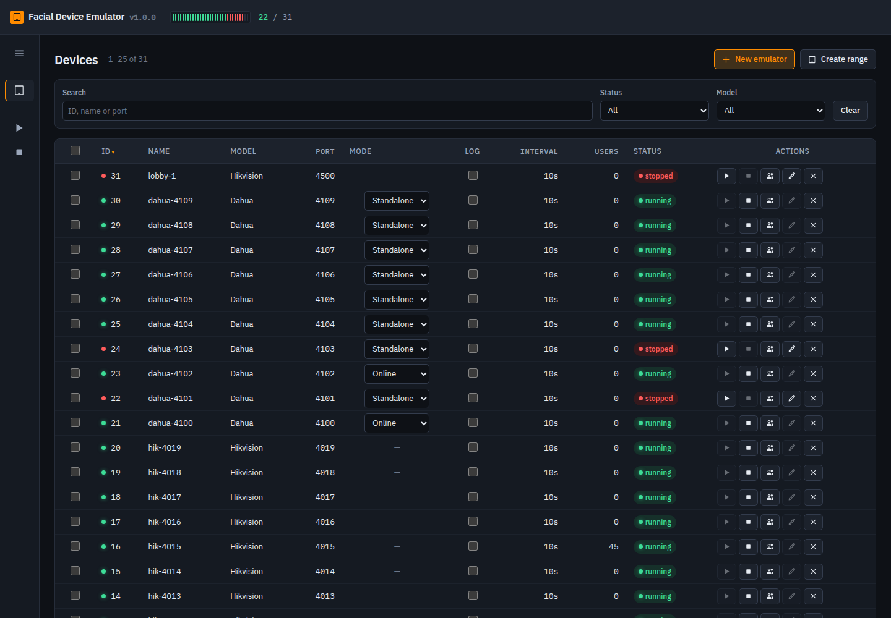
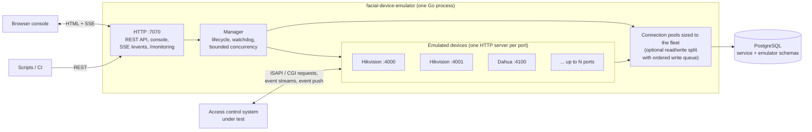
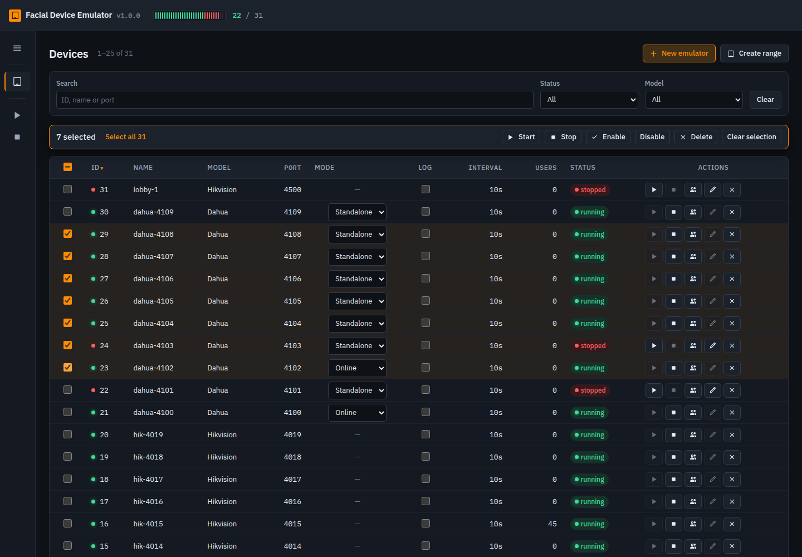

# Facial Device Emulator

[](https://github.com/rphpires/facial-device-emulator/actions/workflows/ci.yml)
[](go.mod)
[](LICENSE)

A Go service that emulates Hikvision (ISAPI) and Dahua (CGI) facial access control
terminals, hundreds at a time, so an access control system can be developed and
load-tested against a realistic fleet without buying the hardware.



## Why it exists

An access control platform that manages facial terminals spends most of its time talking
to them: pushing users, cards, faces and fingerprints, keeping clocks in sync, holding
long-lived event streams open and answering online verification requests. Bugs in that
layer only show up at scale (a sync that is fine with 5 devices and falls over with 500),
and a rack of real terminals is expensive and slow to reset.

This emulator gives every virtual device its own TCP port and HTTP server speaking the
vendor protocol, with per-device state in PostgreSQL. Point the system under test at
`host:4000-4999` and it sees a fleet of terminals. The emulator is built so that it is
never the bottleneck of the test: device lifecycle work runs with bounded concurrency,
the database layer uses connection pools sized to the fleet, and the console does not
poll.

## Features

**Device protocols** (each device is a full HTTP server on its own port)

| Area | Hikvision ISAPI | Dahua CGI |
|---|---|---|
| Device info, time | `System/deviceInfo`, `System/time` (GET/PUT) | `magicBox.cgi?action=getSoftwareVersion`, `global.cgi` get/setCurrentTime |
| Configuration | `AccessControl/AcsCfg`, `AcsEvent/StorageCfg`, `Door/param/1`, `capabilities` | `configManager.cgi` getConfig/setConfig (persisted per device) |
| Users | `UserInfo/Count`, `Search`, `Record`, `Modify`, `UserInfoDetail/Delete` | carried by the card records below |
| Cards | `CardInfo/Count`, `Search`, `Record`, `Delete` | `recordUpdater.cgi` insert/remove, `recordFinder.cgi` (`AccessControlCard`) |
| Faces | `Intelligent/FDLib`: `FaceDataRecord`, `FDSetUp`, `FDSearch`, `FDSearch/Delete`, `Count`, face picture download | `FaceInfoManager.cgi` add/update/find/remove, `AccessFace.cgi` insertMulti/updateMulti/list/get |
| Fingerprints | `FingerPrint/SetUp`, `FingerPrintUploadAll`, `FingerPrint/Delete`, `CaptureFingerPrint` | `accessControl.cgi?action=captureFingerprint` (with enrollment event) |
| Door / outputs | `RemoteControl/door/:id`, `System/IO/outputs/:id/trigger` | `accessControl.cgi` openDoor/closeDoor |
| Event history | `POST AccessControl/AcsEvent` (search) | `recordFinder.cgi` (`AccessControlCardRec`) |
| Event stream | `Event/notification/alertStream` (multipart, heartbeats) | `snapManager.cgi` (text + JPEG) and `eventManager.cgi` (text only) |
| Event push | `Event/notification/httpHosts` + multipart POST to the configured host, `remoteCheck` | HTTP upload to the configured server, keep-alive GETs |

The Dahua emulator also accepts the `Intelbras_ModeCfg.*` configuration keys (device mode,
keep-alive) that Dahua-based OEM firmware uses, so clients written for those OEM terminals
work unchanged. Event pictures are a neutral placeholder image bundled with the project
(`assets/device/photo.jpg`).

Events are generated every `event_interval` seconds from the users and cards the system
under test enrolled on that device. In **standalone** mode they go out on the open event
stream; in **online** mode the device asks the server to verify the access (remote check)
and then emits the door open/close events. Streaming endpoints hijack the connection to
reproduce the vendors' raw multipart framing (no chunked encoding).

**Fleet management**

- Create one device or a port range (up to 1000 devices in one call); edit and delete.
- Start/stop one device, a selection (`POST /api/emulators/batch`) or the whole fleet.
- Per-device online/standalone mode, enable/disable, and an opt-in request log per device
  (view it in the browser or download it as a zip).
- A watchdog reconciles desired and actual state every 10 seconds: a device whose HTTP
  server exited on its own is restarted, and a device serving while stopped or disabled is
  stopped (each after 3 consecutive checks).

**Operations**

- Web console with live updates over Server-Sent Events: filters, sorting, paging,
  multi-select batch actions, and a per-device drawer with enrolled users and stored
  settings.
- Reachability check: warns when a device port will not be reachable from outside
  (port not published by Docker, WSL without mirrored networking, failed bind).
- Health, metrics and runtime endpoints under `/monitoring`.
- Distribution packages for Docker, Linux and Windows (with a bundled portable PostgreSQL).

## Architecture



More detail in [docs/architecture.md](docs/architecture.md).

## Quick start (Docker Compose)

Requirements: Docker with Compose v2.

```bash
git clone https://github.com/rphpires/facial-device-emulator.git
cd facial-device-emulator
docker compose up -d --build --wait
```

Open http://localhost:7070. Then create and start devices from the console, or with the
API:

```bash
# 20 Hikvision terminals on ports 4000-4019, started right away
curl -X POST http://localhost:7070/api/emulators/range \
  -H 'Content-Type: application/json' \
  -d '{"name_prefix":"hik","model":"Hikvision","port_start":4000,"port_end":4019,"auto_start":true}'

# 10 Dahua terminals on 4100-4109, then start everything and wait for it
curl -X POST http://localhost:7070/api/emulators/range \
  -H 'Content-Type: application/json' \
  -d '{"name_prefix":"dahua","model":"Dahua","port_start":4100,"port_end":4109}'
curl -X POST 'http://localhost:7070/api/emulators/start?wait=true'

# Talk to a device the way an access control system would
curl http://localhost:4000/ISAPI/System/deviceInfo
curl 'http://localhost:4100/cgi-bin/magicBox.cgi?action=getSoftwareVersion'
```

Host ports are configurable without editing the compose file, for example
`WEB_PORT=17070 DEVICE_PORT_RANGE=4000-4099 docker compose up -d --build`.
Stop with `docker compose down` (add `-v` to also delete the database).

Other ways to run it (Linux and Windows packages, from source) are in
[docs/getting-started.md](docs/getting-started.md).

## Running from source

Requirements: Go 1.21+ and PostgreSQL (the compose files and packages use 15), or Docker
for the database only.

```bash
make db-up      # PostgreSQL in Docker on 127.0.0.1:5432 (user emulator / emulator123)
make run        # go run ./cmd/emulator-service -config configs/config.yaml
```

The service creates its schemas and tables on startup. To use a native PostgreSQL
instead, `sudo bash scripts/setup-postgres-local.sh` creates the role and the database
(Debian/Ubuntu).

## Configuration

`configs/config.yaml`, overridable by environment variables. Full reference in
[docs/configuration.md](docs/configuration.md).

| Setting | YAML key | Environment | Default |
|---|---|---|---|
| Listen address | `server.host` | `SERVER_HOST` | `0.0.0.0` |
| Console/API port | `server.port` | `SERVER_PORT` | `7070` |
| Database host | `service_db.host` | `DB_HOST` | `127.0.0.1` |
| Database port | `service_db.port` | `DB_PORT` | `5432` |
| Database user | `service_db.username` | `DB_USER` | `emulator` |
| Database password | `service_db.password` | `DB_PASSWORD` | `emulator123` |
| Database name | `service_db.database` | `DB_DATABASE` | `emulator_db` |
| Device time zone | `emulator.default_timezone` | `EMULATOR_DEFAULT_TIMEZONE` | `UTC` |
| Log level | `log.level` | `LOG_LEVEL` | `info` |
| Log format | `log.format` | `LOG_FORMAT` | `text` (or `json`) |
| Log file (besides stdout) | `log.file` | `LOG_FILE` | unset (`logs/trace.log` in the packages and compose) |
| Reset a mismatched database (drops data) | `service_db.reset_on_mismatch` | `DB_RESET_ON_MISMATCH` | `false` (also flag `-reset-db`) |
| Read/write pool split | - | `USE_DUAL_POOL_MANAGER=true` | off |
| Published port range (Docker) | - | `PUBLISHED_PORT_RANGE` | unset |
| Host networking (Docker) | - | `HOST_NETWORK=1` | unset |

The `DB_*` variables are also accepted with the `PG_` and `POSTGRES_` prefixes. The
config file path is set with the `-config` flag.

## Device management

| Task | Console | API |
|---|---|---|
| Create one device | **New emulator** | `POST /api/emulators` |
| Create a port range | **Create range** | `POST /api/emulators/range` (max 1000 ports) |
| Edit (device must be stopped) | row **Edit** | `PUT /api/emulators/:id` |
| Delete (purges its data) | row **Delete** | `DELETE /api/emulators/:id` |
| Start / stop one | row buttons | `POST /api/devices/:id/start`, `/stop` |
| Act on a selection | tick rows, use the batch bar | `POST /api/emulators/batch` |
| Start / stop all | side rail | `POST /api/emulators/start`, `/stop` (`?wait=true` to block) |

Batch actions are `start`, `stop`, `enable`, `disable`, `delete`, `enable_log` and
`disable_log`. The response reports every device individually; devices already in the
requested state count as `skipped`, not failed:

```bash
curl -X POST http://localhost:7070/api/emulators/batch \
  -H 'Content-Type: application/json' -d '{"ids":[2,4,6],"action":"stop"}'
# {"action":"stop","requested":3,"succeeded":3,"failed":0,"skipped":0,
#  "results":[{"id":2,"ok":true},{"id":4,"ok":true},{"id":6,"ok":true}]}
```



## REST API

All routes are registered in [internal/handlers/handlers.go](internal/handlers/handlers.go).
Request and response examples are in [docs/api.md](docs/api.md).

| Method | Path | Purpose |
|---|---|---|
| GET | `/` | Web console (devices page) |
| GET | `/events` | Server-Sent Events stream of fleet changes |
| GET | `/api/emulators` | List devices |
| POST | `/api/emulators` | Create a device (optional `auto_start`) |
| POST | `/api/emulators/range` | Create one device per port in a range |
| PUT | `/api/emulators/:id` | Edit a stopped device |
| DELETE | `/api/emulators/:id` | Delete a device and its data |
| POST | `/api/emulators/batch` | Apply one action to a list of device IDs |
| POST | `/api/emulators/start` | Start every enabled device (202, or 200 with `?wait=true`) |
| POST | `/api/emulators/stop` | Stop every running device (202, or 200 with `?wait=true`) |
| GET | `/api/devices` | List devices |
| GET | `/api/devices/:id` | Get one device |
| POST | `/api/devices/:id/start` | Start one device |
| POST | `/api/devices/:id/stop` | Stop one device |
| GET | `/api/devices/:id/mode` | Read the online/standalone mode |
| POST | `/api/devices/:id/mode` | Set the online/standalone mode |
| PUT | `/api/devices/:id/settings` | Turn the per-device request log on or off |
| GET | `/api/devices/:id/settings` | Settings the system under test wrote to the device |
| GET | `/api/devices/:id/users` | Users enrolled on the device (paged, searchable) |
| GET | `/api/devices/:id/log` | Current request log (text) |
| GET | `/api/devices/:id/log.zip` | All request log files (zip) |
| GET | `/api/status` | Fleet counters |
| GET | `/api/pool-stats` | Database pool statistics |
| GET | `/api/reachability` | Which device ports are reachable in this environment |

## Monitoring

| Path | Purpose |
|---|---|
| `GET /monitoring/health` | Runs every health checker (database pools, fleet); 503 when unhealthy |
| `GET /monitoring/health/quick` | Cached health result, used by the start scripts and the Docker healthcheck |
| `GET /monitoring/metrics` | Request, database and emulator lifecycle metrics |
| `GET /monitoring/metrics/endpoints` | Per-endpoint request counts, errors and latency |
| `GET /monitoring/metrics/errors?limit=N` | Endpoints with the most errors |
| `GET /monitoring/metrics/database` | Connection pool statistics |
| `GET /monitoring/debug/goroutines` | Goroutine count |
| `GET /monitoring/debug/memory` | Go runtime memory statistics |

Each device also answers `GET /emulator/get-status` (and `/status`, `/health` on
Hikvision) with its own state, user count and, on Hikvision, uptime.

## Design notes

- **One process, many servers.** Each device is a Gin engine on its own listener. The
  manager reserves a device ID and starts it without holding its main lock, so the
  console stays responsive while a large fleet comes up. A start that does not finish in
  10 seconds is aborted and reported.
- **Bounded concurrency.** "Start all" runs 20 starts at a time with up to 3 attempts per
  device and pauses the watchdog during the ramp. Batch actions and `auto_start` on a
  range run 32 at a time under a 5-minute budget; items not reached in time are reported
  as failed, never left running after the response.
- **Database pools sized to the fleet.** At startup the service counts the enabled devices
  and sizes a pgx pool once (5 to `3 x (2n+5)` connections, opened lazily as queries
  need them). With `USE_DUAL_POOL_MANAGER=true` it splits reads and
  writes: a large read pool, and a small write pool fed by an ordered write queue that
  batches writes while preserving per-device order.
- **Port limits.** A range is capped at `MaxRangeSize = 1000` ports, the width of the
  `4000-4999` range the compose file publishes. Ports already used by another device, or
  the service's own port, are rejected with a 400 that lists the conflicts.
- **No polling.** The console receives a snapshot and then deltas over SSE; bursts (such
  as "start all") are coalesced into one frame per 150 ms.
- **Protocol fidelity first.** Streaming endpoints write raw multipart over a hijacked
  connection, event pushes use `multipart/form-data` like real devices, and Dahua
  responses include a small simulated latency.

## Project layout

```
cmd/emulator-service/   entry point (config, migrations, manager, HTTP server)
internal/emulator/      manager, device CRUD, fleet events
  hikvision/            ISAPI emulator: routes, events, repository
  dahua/                CGI emulator: routes, streams, config store, repository
internal/handlers/      REST API, batch actions, SSE stream, console rendering
internal/database/      connection pools, ordered write queue, schema check, migrations
internal/devicelog/     per-device request log (rotation, sanitizing, zip)
internal/reachability/  environment detection and port reachability analysis
internal/monitoring/    health checks, metrics, middleware
internal/config/        YAML + environment configuration
assets/                 embedded web console and SQL migrations (go:embed)
configs/                default configuration
packaging/              Docker, Linux and Windows distribution packages
docs/                   manual
```

## Development

```bash
make test        # go test ./...
make test-race   # go test -race ./...
make vet         # go vet ./...
make lint        # golangci-lint v1.64.x, configuration in .golangci.yml
make build       # bin/facial-device-emulator
make help        # all targets
```

CI ([.github/workflows/ci.yml](.github/workflows/ci.yml)) runs build, vet, race-enabled
tests, golangci-lint and a Docker image build on every push and pull request.

## Documentation

- [Getting started](docs/getting-started.md): Docker, Linux and Windows packages, from source
- [Configuration](docs/configuration.md)
- [Web console](docs/web-console.md)
- [REST API reference](docs/api.md)
- [Ports and networking](docs/ports-and-networking.md)
- [Load testing with a large fleet](docs/load-testing.md)
- [Architecture](docs/architecture.md)
- [Troubleshooting](docs/troubleshooting.md)

## License

[MIT](LICENSE)
