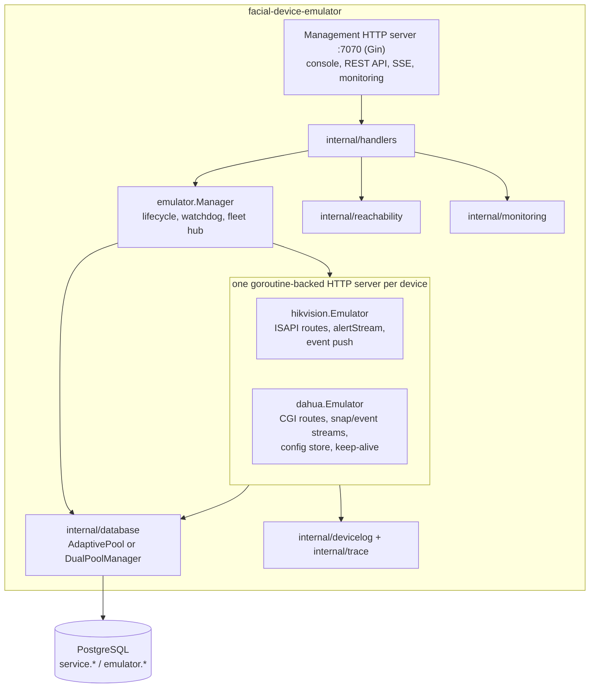

# Architecture

One Go process hosts the management service and every emulated device. PostgreSQL holds
both the fleet definition and the state each device accumulates.

## Startup

`cmd/emulator-service/main.go`:

1. Load the YAML config and environment overrides (`internal/config`).
2. Configure the service log (`internal/trace`, see
   [configuration.md](configuration.md#logging)).
3. Check the database structure. On an empty database, create the `service` and
   `emulator` schemas from the embedded baseline migration, in one transaction. If the
   structure is complete, go on. If it is partial or a critical column is missing,
   **refuse to start** with the list of what is missing, unless `-reset-db` or
   `service_db.reset_on_mismatch: true` allows dropping and recreating both schemas
   (all their data).
4. Open the connection pools and apply pending migrations from `assets/migrations`
   (each in its own transaction, tracked in `service.schema_migrations`).
5. Create the manager: reset every device to `stopped`, seed the watchdog, start it.
6. Build the router (`internal/handlers`) and serve on `server.host:server.port`.
   `WriteTimeout` is the batch budget plus 30 s (`handlers.ServerWriteTimeout`); the
   `/events` stream clears its own write deadline so it is not cut.
7. On SIGINT/SIGTERM: cancel every request context (open `/events` streams end at
   once), drain the HTTP server for up to 5 s, stop every device, close the pools. The
   compose files give the container a 20 s stop grace period for this.

Devices are never started automatically at boot.

## Device lifecycle

`emulator.Manager` owns the map of running emulators. Every emulator implements a small
interface (`Start`, `Stop`, `IsRunning`, `GetInfo`, `GenerateEvent`, `GetType`,
`GetTotalUsers`).

- **Start.** The manager reserves the device ID in a `starting` set and releases its lock
  before calling `Start`, because loading state can take time and the same lock serves
  the fleet listing the console reads. The emulator binds its port synchronously
  (`net.Listen`) and only then serves in a goroutine, so a taken port fails the start
  (`409`) instead of being reported as running. `Start` runs with a 10-second timeout; if
  a timed-out start completes later, the manager stops what it started so no untracked
  listener keeps the port. A timeout or bind error is recorded as the device's last start
  error and surfaces in the console and in the reachability report.
- **Run state.** Each emulator keeps an atomic running flag and a stop channel created per
  run: the event generator, keep-alive and stream goroutines capture the channel of the
  run that launched them. If the HTTP server exits on its own (not through `Stop`), the
  run is marked dead and its goroutines are released.
- **Start all.** Enabled, stopped devices are started 20 at a time, each with up to 3
  attempts one second apart. The watchdog is paused during the ramp and resumed 15
  seconds after it.
- **Stop / stop all.** The manager removes the emulator from its map under the lock and
  stops it outside the lock (putting it back if the stop fails), so listing never blocks
  on a slow stop. Stop all swaps the whole map out the same way.
- **Watchdog.** Every 10 seconds it compares each device's desired state (the stored
  `status`, written `running` by a successful start and `stopped` by a stop, together with
  `enabled`) with its actual state (whether its emulator is serving). A device that should
  run but is not serving (its server died) is restarted after 3 consecutive checks; a
  device serving while stored as stopped or disabled is stopped after 3 checks. Devices
  whose start is in progress are skipped. It also refreshes each running device's user
  count, writing to the database only when the number changed.
- **CRUD.** Create, range create, update and delete go through `internal/emulator/crud.go`.
  Port conflicts are detected inside the creating transaction and returned as a typed
  error listing the ports. Updates require the device to be stopped (a running emulator
  keeps an in-memory copy of its definition). Delete stops the device and purges every
  table that references it.

## Protocol emulation

Each device is a Gin engine on `0.0.0.0:<port>` with the vendor's routes
(`internal/emulator/hikvision/handlers*.go`, one file per area, and
`internal/emulator/dahua/handlers.go`). Some details that matter for fidelity:

- **Streams over hijacked connections.** Hikvision `alertStream` and Dahua
  `snapManager.cgi`/`eventManager.cgi` take over the raw TCP connection and write
  `multipart/mixed` / `multipart/x-mixed-replace` parts by hand. Go's `net/http` would
  otherwise add chunked transfer encoding and enforce the write timeout, which real
  devices do not do and some clients cannot parse. Deadlines are cleared so the stream
  stays open indefinitely, with heartbeat parts in between events. Each stream loop blocks
  on its channels (run stop, event interval, heartbeat, pushed parts) instead of polling,
  and ends as soon as a write or flush fails. The Dahua loop caches the operating mode and
  re-reads it every 5 seconds, ending the stream when the device switches to online.
- **Event push.** In online mode Hikvision posts events to the host configured through
  `PUT /ISAPI/Event/notification/httpHosts` as `multipart/form-data` (an `event_log` JSON
  part and a JPEG part), exactly as a device does; the server's answer comes back on
  `PUT /ISAPI/AccessControl/remoteCheck`. Dahua sends events to the upload server set
  through `configManager.cgi?action=setConfig` and issues periodic keep-alive GETs when
  the client enables them.
- **Device identity.** Each emulator has a MAC address and a derived link-local IPv6
  address, reported in device info and events.
- **Simulated latency.** Dahua text responses are written after a small per-action delay.
- **History.** Generated events are kept in a bounded in-memory log per device, served by
  the event history searches (`AcsEvent`, `recordFinder.cgi`) and purged by
  `AcsEvent/StorageCfg`.

## Data model

`assets/migrations/V001_create_emulator_schema.sql`:

| Schema.table | Content |
|---|---|
| `service.devices` | One row per emulated device: name, model, port (unique), status, enabled, interval, user count, log flag |
| `service.schema_migrations` | Applied migrations |
| `emulator.device_settings` | Key/value settings per device (mode, event server, vendor config keys). The event server port defaults to `models.DefaultEventServerPort` (8080) until the client configures one |
| `emulator.hikvision_users`, `hikvision_cards`, `hikvision_faces`, `hikvision_fingers` | Hikvision enrollment data |
| `emulator.dahua_cards`, `dahua_faces` | Dahua enrollment data |

All per-device tables are keyed by `device_id`.

## Database layer

`internal/database` exposes one interface (`DBInterface`: `Query`, `QueryRow`, `Exec`,
`Begin`, `Ping`) with two implementations, chosen at startup:

**AdaptivePool (default).** A `pgxpool` wrapper sized once, at startup, from the number
of enabled devices `n`: minimum 5 connections, maximum `3 x (2n + 5)`. The pool is never
recreated. pgxpool opens connections lazily as queries need them and closes those idle
for 5 minutes, so the open count follows the load between the two bounds. Pool
statistics (open, acquired and idle connections, the peak and average query time of the
current 2-minute period, and `empty_acquire_count`, acquires that had to wait for a
connection) are exposed at `/api/pool-stats`; the health checker warns when acquired
connections approach the maximum.

**DualPoolManager (`USE_DUAL_POOL_MANAGER=true`).** Splits traffic:

- a large **read pool** for queries;
- a small **write pool** used only by an **ordered write queue**: a buffered channel of
  operations processed by `sqrt(n)` workers (clamped to 5-50), flushed in batches
  (`10 x log10(n)` operations, at least every `5000 / log10(n)` ms), with per-device
  sequence numbers so writes from one device are applied in order, and retries with
  exponential backoff for transient errors.

Sizing formulas live in `internal/database/dynamic_config.go`; computed values for 100,
300 and 1000 devices are listed in [load-testing.md](load-testing.md#4-database). The
service opens two of these (fleet management and per-device state) against the same
database.

## Realtime updates

The manager publishes a `FleetEvent` (`changed`, `removed`, `resync`) whenever a device
changes. The fleet hub fans events out to listeners synchronously and without blocking,
so delivery order matches the order of the changes; a listener whose 1024-slot buffer is
full gets an overflow flag instead and resynchronizes.

`GET /events` (`internal/handlers/stream.go`) subscribes to the hub, sends a full
snapshot, then coalesces changes for 150 ms and sends one `delta` with only the changed
devices and the removed IDs. Device modes for the whole fleet are read in one query per
frame, not one per device. A comment frame every 20 seconds keeps proxies from closing
the connection.

## Web console

Server-rendered Go templates plus plain JavaScript modules (`assets/web`), embedded into
the binary with `go:embed`. The first paint embeds the current fleet in the page so it
does not wait for the stream; after that, filtering, sorting and paging run client-side
on the state kept current by the SSE stream.

## Monitoring and logging

- `internal/monitoring`: a recovery middleware, a metrics middleware recording count,
  latency and errors per route, and health checkers for both database pools and the
  fleet. `/monitoring/health/quick` serves a cached result.
- `internal/trace`: the service log, a thin printf-style layer over `log/slog`. Text or
  JSON (`log.format`), level filter (`log.level`), written to stdout and, when
  `log.file` is set, also to that file, rotated by size (`trace.log.1`, `.2`, ...). The
  standard `log` package is routed through the same handler, so every line has the same
  format. See [configuration.md](configuration.md#logging).
- `internal/devicelog`: the opt-in per-device request log. Bodies are sanitized
  (identifying fields kept, images and long values truncated) and capped at 2 KB; files
  rotate at 3 MB with 8 kept, and are deleted when the log is turned off.

## Reachability

`internal/reachability` detects the environment once at startup (Docker, WSL, Windows,
Linux, plus `PUBLISHED_PORT_RANGE`, `HOST_NETWORK`, WSL mirrored mode and the open files
limit) and exposes a pure `Analyze` function that turns device ports and their last bind
errors into verdicts. It never changes ports or blocks a device; it only tells the
operator which devices the system under test will not be able to reach. See
[ports-and-networking.md](ports-and-networking.md#reachability-check).

## Testing

Unit tests run without a database: the manager, handlers and both emulators are tested
against in-memory fakes of `DBInterface`, and HTTP behavior with `httptest`. A contract
test checks that the Docker package's compose files and `PUBLISHED_PORT_RANGE` agree. CI
runs `go test -race ./...`.
