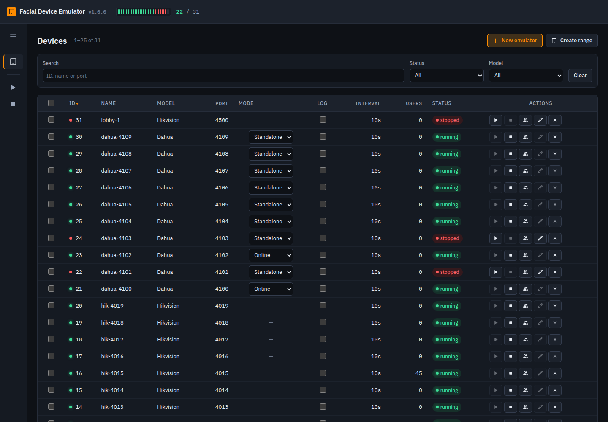
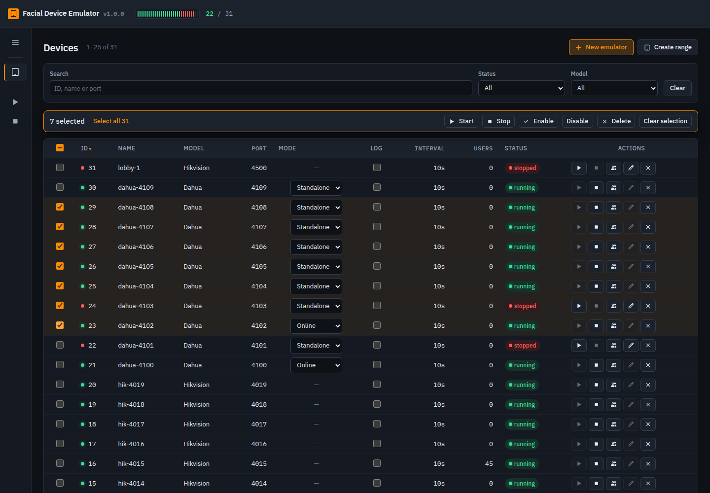

# Web console

The console is served by the service itself at `http://<host>:7070/`. It is a single
page (Devices) built with server-rendered HTML, plain JavaScript and no build step; all
assets are embedded in the binary.

## Live updates

The page opens a Server-Sent Events stream (`GET /events`). The server first sends a
`snapshot` with the whole fleet and the counters, then `delta` frames as devices change
(start, stop, edit, new users enrolled, mode changes). Bursts are coalesced into one
frame every 150 ms, so "Start all" on a large fleet does not flood the browser. Nothing
on the page polls.

The header meter shows one segment per device and the `running / total` count. When the
stream drops it shows `reconnecting...`, and `offline` if it stays down; the browser
reconnects on its own after 3 seconds.

## Devices table

| Column | Meaning |
|---|---|
| ID, Name, Model, Port | Device identity. The port is where the system under test connects |
| Mode | Dahua only: `Online` or `Standalone`, editable inline (see below) |
| Log | Per-device request log on or off |
| Interval | Seconds between generated events |
| Users | Users enrolled on the device by the system under test (refreshed by the watchdog) |
| Status | `running`, `stopped`, `disabled`, or `error` (stopped after a failed start; hover it to see the error) |
| Actions | Start, Stop, Users and settings (drawer), Edit (stopped devices only), Delete |

Filtering by text (ID, name or port), status and model, sorting and paging all happen in
the browser, on the fleet already received. The filter state is kept in the URL, so a
link or a reload shows the same slice. Rows per page: 10, 25, 50 or 100.

### Mode

- **Standalone**: the device decides access on its own and reports events on the event
  stream the access control system keeps open.
- **Online**: the device asks the server to verify every access (remote check) and only
  then reports the door events.

For Dahua devices the mode can be changed from the table (`POST /api/devices/:id/mode`).
Hikvision devices take their mode from the access control system, which writes it with
`PUT /ISAPI/AccessControl/AcsCfg` (`remoteCheckDoorEnabled`), so the column shows a dash.

## Creating devices

- **New emulator**: name, model, IP address (only reported in the device's responses),
  port, event interval, enabled, and "Start after creating".
- **Create range**: name prefix, model, IP address, first and last port (up to 1000
  ports), event interval, enabled, start after creating. Each device is named
  `<prefix>-<port>`.

Port conflicts (with another device or with the service's own port) are reported in the
form, listing the offending ports.

## Batch actions

Tick the row checkboxes (or the header checkbox for the current page) to show the batch
bar. "Select all N" extends the selection to every device matching the current filter.
The selection survives paging and filtering.

Available actions: **Start**, **Stop**, **Enable**, **Disable**, **Delete** and **Clear
selection**. Delete, and disabling running devices, ask for confirmation. Every action
goes through `POST /api/emulators/batch`; the toast reports how many succeeded, were
skipped (already in the requested state) or failed.

## Start all / Stop all

The side rail has **Start all** and **Stop all**. Both return immediately and the
progress is visible in the table as devices change state. "Start all" starts every
enabled, stopped device.

## Device drawer

The **Users and settings** button on a row opens a drawer with two tabs:

- **Users**: the users enrolled on the device, with card number, whether a face is
  enrolled and the validity end date. Searchable by name or ID and paged. Read from the
  database, so it works with the device stopped.
- **Settings**:
  - **Record event log**: turns the per-device request log on or off. The log keeps the
    last 8 files of 3 MB; turning it off deletes them. When on, **View log** opens the
    current file in the browser and **Download logs (.zip)** downloads all of them.
  - **Settings written by the access control system**: the raw key/value settings stored
    for the device (event server address, mode, vendor config keys).

The request log records connections, every incoming request with status, timing and a
sanitized body excerpt (images and long values are truncated), and every outgoing event
push.

## Reachability warning

When some devices will not be reachable from outside, a warning appears above the
filters with the reason and a list of the affected devices. Typical causes: a port
outside the range Docker publishes, WSL without mirrored networking, or a port the
operating system refused to open. See [ports-and-networking.md](ports-and-networking.md).
